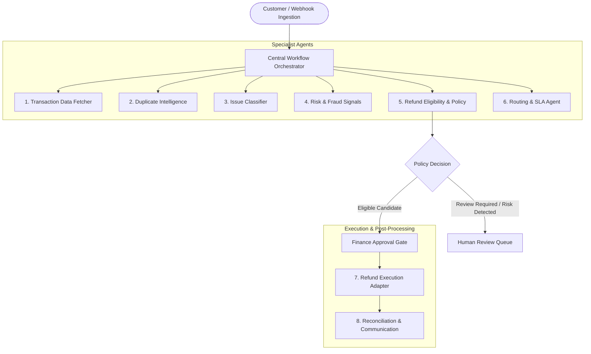
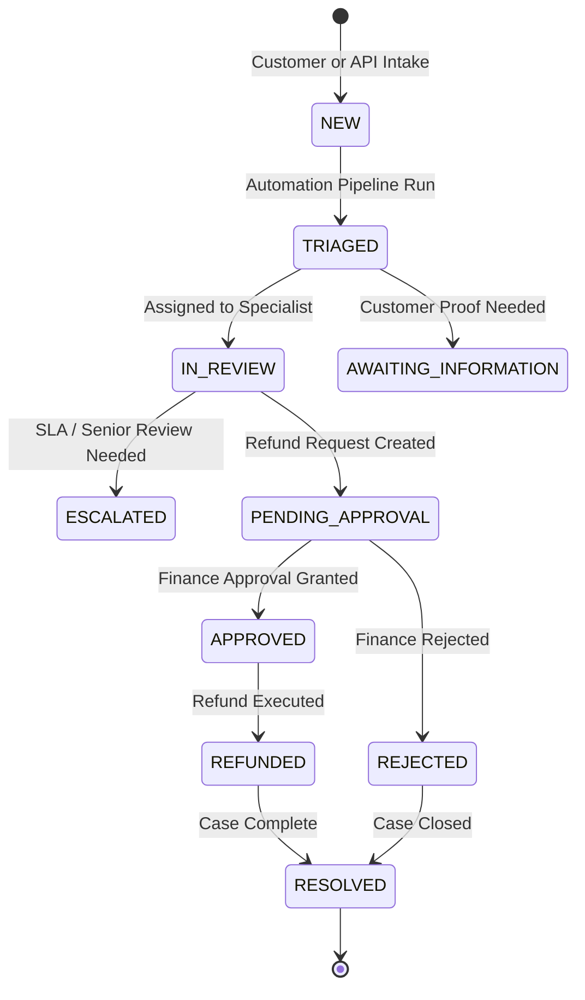

# RITOS Automation & Multi-Agent Intelligence System
## Architecture, Technical Specification, and Operating Philosophy

---

### 1. Executive Summary & Problem Space

In modern ecommerce and digital payment platforms, refund processing represents one of the highest financial risks and operational bottlenecks:
- **Refund & Friendly Fraud**: Customers or malicious actors claim non-receipt, duplicate charges, or unauthorized transactions to obtain illicit payouts.
- **Fragmented Systems**: Support agents lack direct, real-time access to payment gateway ledgers, leading to decisions based on incomplete customer assertions.
- **Duplicate Payouts**: Concurrent or repeated tickets often lead to multiple customer service representatives initiating refunds for the same transaction.
- **Regulatory & Compliance Demands**: Financial auditing requires strict Segregation of Duties (SoD), non-repudiable audit logs, and deterministic proof of authorization.

**RITOS (Refund Intelligence & Ticket Orchestration System)** resolves these challenges by coupling an **intake-to-settlement state machine** with a **deterministic-first multi-agent automation pipeline**.

---

### 2. Core Philosophy: Why Deterministic-First?

> [!IMPORTANT]
> **Financial Safety Axiom**: Large Language Models (LLMs) and heuristic AI classifiers must **NEVER** possess write-access to financial ledgers, payment gateways, or money movement APIs without deterministic validation and authorized human approval.

In RITOS:
1. **Customer claims are hypotheses, not evidence.** A customer asserting "I was charged twice" triggers a verification workflow; it never authorizes an automated refund.
2. **AI models enrich text comprehension; deterministic engines enforce financial rules.** NLP categorizes issues and extracts customer sentiment/evidence, but ledger balances, currency matching, and idempotency checks are strictly mathematical and database-enforced.
3. **Four-Eyes Segregation of Duties**: The user creating a refund request cannot approve it; the user approving cannot execute it without role-based separation.

---

### 3. Multi-Agent Architecture Overview

The RITOS automation plane consists of **8 Specialist Agents** coordinated by a **Central Workflow Orchestrator**.



---

### 4. Deep Dive: The 8 Specialist Agents

#### Agent 1: Transaction Data Fetcher (`transaction_data_fetcher`)
- **Mode**: Deterministic Database & Provider Query
- **Purpose**: Retrieves the ground-truth payment record corresponding to the customer's claimed `transaction_id`.
- **Validation Rules**:
  - `TRANSACTION_NOT_FOUND`: If no transaction exists matching the identifier.
  - `CUSTOMER_MISMATCH`: If the transaction belongs to an account other than the authenticated claimant.
  - `AMOUNT_MISMATCH`: If the claimed amount or currency diverges from the actual ledger amount.
  - `ALREADY_REFUNDED`: If `refunded_amount >= original_amount`.
  - `PAYMENT_PENDING`: If provider status is not yet `SUCCESSFUL`.
- **Output**: Verified transaction entity or specific exception flag.

#### Agent 2: Duplicate Intelligence (`duplicate_intelligence`)
- **Mode**: Algorithmic Linkage & Heuristic Matching
- **Purpose**: Identifies duplicate customer submissions and separates them from legitimate duplicate charges.
- **Key Distinction**:
  - *Duplicate Ticket*: A customer filing multiple tickets for the exact same transaction ID. RITOS links these to the canonical ticket (`duplicate_of_id`) to prevent redundant agent effort.
  - *Duplicate Payment*: Two separate provider transaction IDs for a single order ID. This is flagged for Payment Investigation, not closed as a duplicate ticket.
- **Guardrail**: A duplicate link **never** auto-closes or auto-rejects a case. It flags the relation for human inspection.

#### Agent 3: Issue Classification & Evidence Extraction (`issue_classifier`)
- **Mode**: Rule-Based Pattern Matching (extensible to LLM/embeddings)
- **Purpose**: Maps raw customer descriptions into standardized operational categories with extracted evidence and confidence scores.
- **Supported Categories**:
  - `UNAUTHORIZED_PAYMENT` (Fraud / Stolen card allegations)
  - `DUPLICATE_PAYMENT` (Charged twice for one transaction)
  - `PAYMENT_ORDER_FAILED` (Money deducted, order not created)
  - `REFUND_NOT_RECEIVED` (Settlement delay inquiry)
  - `INCORRECT_REFUND_AMOUNT` (Partial or short refund discrepancy)
  - `CANCELLATION_REFUND` / `RETURN_ELIGIBILITY`
- **Output**: Category label, confidence rating (0.0 to 1.0), matched keyword evidence, and standardized recommended operational action.

#### Agent 4: Risk & Fraud Signals (`risk_assessment`)
- **Mode**: Multi-Factor Risk Scoring
- **Purpose**: Generates review indicators across transactions and claim patterns.
- **Risk Signals Evaluated**:
  - `UNAUTHORIZED_PAYMENT_REPORT` (High severity): Requires instant security review and account freezing checks.
  - `TRANSACTION_VERIFICATION_EXCEPTION` (High severity): Claim amount greater than ledger amount or customer ID mismatch.
  - `POSSIBLE_DUPLICATE_TICKET` (Medium severity): Multiple claims on the same transaction.
- **Guardrail**: Risk signals are **review triggers, never proof of fraud**. No customer is rejected or penalized automatically based on risk signals alone.

#### Agent 5: Refund Eligibility & Policy Engine (`eligibility_policy`)
- **Mode**: Conservative Deterministic Policy Evaluation
- **Purpose**: Evaluates whether a transaction satisfies all prerequisites for refund consideration.
- **Eligibility Conditions**:
  1. Transaction status is `VERIFIED`.
  2. Transaction has remaining refundable balance (`amount > refunded_amount`).
  3. Zero High-Severity risk signals active.
  4. Ticket category is compatible with refund workflows.
- **Outputs**:
  - `ELIGIBLE_FOR_AUTHORIZED_REFUND_REVIEW`: Transaction qualifies for an authorized staff member to submit a refund request.
  - `HUMAN_REVIEW_REQUIRED`: Discrepancy exists; manual triage required.
  - `NO_DUPLICATE_REFUND`: Transaction already fully refunded.

#### Agent 6: Routing & SLA Agent (`routing_sla`)
- **Mode**: Priority & Queue Assignment Table
- **Purpose**: Routes cases to specialized queues and assigns urgency levels (P1 to P4).
- **Routing Rules**:
  - `UNAUTHORIZED_PAYMENT` &rarr; **Security and Fraud Review** (Priority `P1` - Critical)
  - `DUPLICATE_PAYMENT` &rarr; **Payment Investigation** (Priority `P2` or `P3`)
  - `REFUND_NOT_RECEIVED` &rarr; **Refund Operations** (Priority `P3`)
  - `RETURN_ELIGIBILITY` &rarr; **Returns and Refunds** (Priority `P3`)
  - Text containing "overdue", "weeks ago", "months ago" &rarr; Escalated to `P2` (High).

#### Agent 7: Refund Execution Adapter (`refund_execution`)
- **Mode**: Idempotent Provider Adapter (Mock / Gateway API)
- **Purpose**: Executes financial refunds strictly after dual authorization.
- **Idempotency Safeguard**:
  ```python
  raw_key = f"ritos-refund:{ticket_id}:{Decimal(amount):.2f}:{currency}"
  idempotency_key = hashlib.sha256(raw_key.encode()).hexdigest()
  ```
  Every request carries an idempotency hash preventing replay attacks or accidental double clicks from submitting duplicate refunds.

#### Agent 8: Reconciliation & Communication (`reconciliation_communication`)
- **Mode**: Event Publisher & Webhook / Audit Dispatcher
- **Purpose**: Reconciles asynchronous gateway settlement webhooks, updates ticket status, notifies customers, and records immutable audit log entries.

---

### 5. Ticket Lifecycle State Machine



---

### 6. Role-Based Access Control (RBAC) Matrix

| Role | Intake & View Own | Queue & Triage | Request Refund | Approve Refund | Execute Refund | Audit Log |
| :--- | :---: | :---: | :---: | :---: | :---: | :---: |
| **Customer** | :white_check_mark: | :x: | :x: | :x: | :x: | :x: |
| **Support Agent** | :x: | :white_check_mark: | :white_check_mark: | :x: | :x: | :x: |
| **Refund Operations** | :x: | :white_check_mark: | :white_check_mark: | :x: | :white_check_mark: | :x: |
| **Finance Approver** | :x: | :white_check_mark: | :x: | :white_check_mark: | :x: | :x: |
| **Risk Analyst** | :x: | :white_check_mark: | :x: | :x: | :x: | :white_check_mark: |
| **Supervisor** | :x: | :white_check_mark: | :white_check_mark: | :white_check_mark: | :x: | :white_check_mark: |
| **Administrator** | :white_check_mark: | :white_check_mark: | :white_check_mark: | :white_check_mark: | :white_check_mark: | :white_check_mark: |
| **Auditor** | :x: | Read-Only | :x: | :x: | :x: | :white_check_mark: |

---

### 7. Production Readiness & Extension Roadmap

1. **LLM Enrichment**: The classification agent is structured to permit an LLM fallback (e.g. Gemini 2.5 Flash / Claude) for multilingual understanding, with outputs strictly validated against the fixed category enum.
2. **Durable Task Queue**: Celery worker entrypoint is scaffolded in `worker.py` for distributed background task execution and retry handling with Redis.
3. **Gateway Adapters**: The mock provider adapter can be swapped with Stripe, Razorpay, Adyen, or PayPal adapters without altering the core pipeline.
