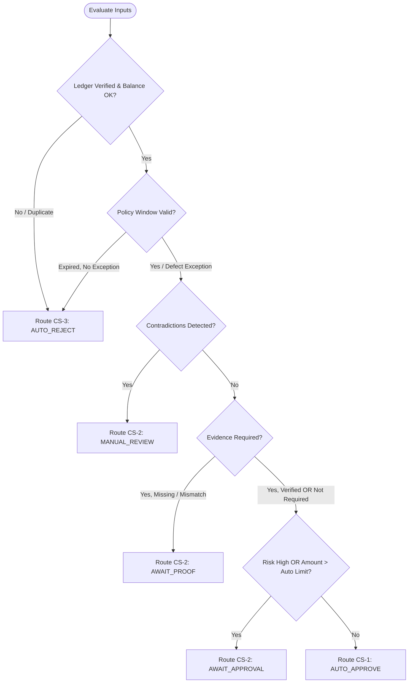

# RITOS Workflow & Agent Orchestration Guide
## Multi-Agent Adjudication, Architecture Specification, AI Boundaries & End-to-End Execution Flow

---

## 1. Executive Summary & Purpose

**RITOS (Refund Intelligence & Ticket Orchestration System)** is an enterprise e-commerce refund governance platform. It automates high-volume refund triage, validates product identity and defect proof via computer vision, enforces category return policies, and executes auditable financial settlements under double-entry accounting.

This document serves as the canonical workflow and architectural reference explaining:
1. **The Architecture Name and Design Pattern** governing the system.
2. **How the Multi-Agent Orchestration Pipeline works** across all specialist agents.
3. **Where and how AI replaces human intervention**, alongside the strict deterministic guardrails preventing automated financial errors.
4. **The Complete End-to-End Flow from Input to Output**, tracing customer claims from initial ingestion to financial payout and reconciliation.

---

## 2. Architecture Name & Structural Patterns

The architecture of RITOS is classified as:

### Primary Architecture
> **Deterministic-First Multi-Agent Orchestration (DF-MAO) with Finite State Machine (FSM)**

Unlike generative or autonomous multi-agent systems where LLMs have open-ended agency, RITOS follows a **Neuro-Symbolic / Deterministic-First** model. In this architecture:
- **Heuristics & AI Models** act as *sensory perception and classification coprocessors* (analyzing text claims and assessing images).
- **Deterministic State Machines & Policy Engines** hold exclusive authority over routing, eligibility, and money movement.

### Core Architectural Patterns Employed

| Architectural Pattern | Implementation in RITOS | Purpose & Invariant |
| :--- | :--- | :--- |
| **Central Orchestrator Pattern** | `backend/app/orchestrator.py` | Coordinates specialist agents in a strict data-dependency graph; records immutable audit traces (`WorkflowRun`, `WorkflowStep`). |
| **Hybrid Neuro-Symbolic Pipeline** | `backend/app/vision.py` & `backend/app/agents/` | Combines OpenCLIP zero-shot neural embeddings with symbolic boolean logic, mathematical thresholds, and versioned policy rules. |
| **Four-Eyes Segregation of Duties (SoD)** | `backend/app/finance.py` | Strictly enforces $\text{Proposer} \neq \text{Approver} \neq \text{Executor}$. No single actor (human or AI) can unilaterally move funds. |
| **Transactional Outbox Pattern** | `backend/app/outbox.py` & `backend/app/shopflow.py` | Decouples external store callbacks from core database transactions, guaranteeing at-least-once asynchronous delivery with exponential backoff. |
| **Double-Entry Financial Journaling** | `backend/app/finance.py` (`LedgerJournal`, `LedgerEntry`) | Books balanced debits and credits in minor integer units ($\sum \text{Debits} = \sum \text{Credits}$), preventing balance drift. |
| **Idempotent Settlement Gate** | `refund_key()` & `compute_payload_fingerprint()` | Cryptographic SHA-256 fingerprinting prevents replay attacks or accidental duplicate refund executions. |

---

## 3. Specialist Agent Roster & Orchestration

The RITOS automation plane consists of **specialist agents** coordinated in dependency order by the **Central Workflow Orchestrator** (`backend/app/orchestrator.py`).

```
                    ┌────────────────────────────────────────────────────────┐
                    │               Central Workflow Orchestrator            │
                    │               (backend/app/orchestrator.py)            │
                    └───────────────────────────┬────────────────────────────┘
                                                │
   ┌────────────────────────────────────────────┴────────────────────────────────────────────┐
   │                                Pipeline Execution Order                                  │
   ▼                                                                                          ▼
[Agent 1: Ledger Ground Truth]                                                  [Agent 5: Carrier & Logistics]
   │                                                                                          │
   └────────────────────────────────────────────┬─────────────────────────────────────────────┘
                                                │
                                                ▼
                                [Agent 3: Claim Intent & Contradictions]
                                                │
                                                ▼
                        [Agent 7: Visual Product Identity (7A) & Defect (7B)]
                                                │
                                                ▼
                                [Agent 2: Return Policy Enforcement]
                                                │
                                                ▼
                                [Agent 4: Risk & Velocity Engine]
                                                │
                                                ▼
                        [Agent 6: Decision Arbiter & Desk Router (GATE)]
                                                │
                        ┌───────────────────────┴───────────────────────┐
                        ▼                                               ▼
            [Agent 9: Review Coordinator]               [Agent 8: Customer Communicator]
            (For CS-2 / CS-3 Human Queues)              (Generates Lifecycle Message)
```

### Detailed Agent Breakdown

#### Agent 1: Ledger Ground Truth & Duplicate Intelligence (`ledger_ground_truth`)
- **Module**: `backend/app/agents/ledger_agent.py`
- **Execution Mode**: Deterministic Database Query & Provider Verification
- **Role**: Establishes ground-truth financial facts. Queries the internal database and payment gateway to verify:
  1. Transaction exists and is in `SUCCESSFUL` payment status.
  2. Transaction belongs to the authenticated customer and matches the currency.
  3. Authoritative refundable balance ($Remaining = \text{Amount} - \text{Refunded} - \text{Pending Reservations}$).
  4. Composite duplicate check: Flags duplicate claims if identical `transaction_id`, `order_id`, and `item_name` match an open or resolved claim.
- **Fail-Safe Output**: `VERIFIED`, `ALREADY_REFUNDED`, `AMOUNT_MISMATCH`, `CUSTOMER_MISMATCH`, or `TRANSACTION_NOT_FOUND`.

#### Agent 5: Carrier & Logistics Verification (`logistics_verification`)
- **Module**: `backend/app/agents/logistics_agent.py`
- **Execution Mode**: Carrier Adapter / Logistics Verification
- **Role**: Validates shipping milestones and proof of delivery:
  1. Retrieves shipment tracking events and delivery timestamps.
  2. Confirms signed delivery flags and carrier exception notices.
  3. Prevents claims from citing "non-delivery" when verified carrier logs show signed receipt.

#### Agent 3: Customer Claim Intent & Contradiction Analysis (`claim_analysis`)
- **Module**: `backend/app/agents/claim_reason_agent.py` & `backend/app/services.py`
- **Execution Mode**: Controlled Taxonomy NLP & Deterministic Contradiction Engine
- **Role**:
  1. Maps raw customer text into controlled categories (`DEFECTIVE_PRODUCT`, `PHYSICAL_DAMAGE`, `LOOSE_STITCHING_SEAM_FAILURE`, `WRONG_PRODUCT_RECEIVED`, `UNAUTHORIZED_PAYMENT`, `DUPLICATE_PAYMENT`, etc.).
  2. Checks for material contradictions between customer claims and facts (e.g., claiming non-delivery after signed carrier delivery; claiming physical breakage on digital goods).

#### Agent 7: Visual Product Identity & Defect Verification (`evidence_verification`)
- **Module**: `backend/app/agents/product_identity_agent.py`, `backend/app/agents/defect_verification_agent.py`, `backend/app/proof_reader.py`, `backend/app/vision.py`
- **Execution Mode**: Classical Image Diagnostics + Semantic Vision Model (OpenCLIP ViT)
- **Sub-Component 7A (Product Identity)**: Compares customer photos against authoritative merchant catalog reference images using cosine embedding similarity.
- **Sub-Component 7B (Defect Verification)**: Evaluates whether the claimed defect is observable using cross-modal prompt competition (`"a close-up photo showing [defect]"` vs `"an undamaged [product] in perfect condition"`).
- **Integrity Pre-Checks**: Validates file magic bytes (JPEG/PNG/WebP), blocks decompression bombs, calculates Laplacian sharpness, and computes 64-bit difference hashes (`dhash`) to detect photo recycling across accounts.

#### Agent 2: Return Policy Enforcement (`policy_enforcement`)
- **Module**: `backend/app/agents/policy_agent.py`
- **Execution Mode**: Versioned Policy Rules Engine
- **Role**:
  1. Resolves applicable policy by product category (e.g., Electronics: 14 days; Lifestyle/Apparel: 30 days; Consumables: Final Sale).
  2. Calculates elapsed time using UTC delivery and purchase dates.
  3. Checks statutory defect exceptions: if Agent 7 verified a manufacturing defect, returns outside the window remain eligible under merchant defect warranty rules.

#### Agent 4: Historical Risk & Velocity Engine (`risk_assessment`)
- **Module**: `backend/app/agents/risk_agent.py`
- **Execution Mode**: Multi-Factor Risk Scoring Engine
- **Role**:
  1. Computes trailing claim velocity across 30, 90, and 365 days.
  2. Evaluates refund-to-lifetime-GMV ratio and previous abuse indicators.
  3. Flags high-value transactions (> ₹5,000 / configured ceiling) requiring mandatory supervisor sign-off.
  4. Produces risk tiers (`LOW`, `MEDIUM`, `HIGH`). Risk signals are strictly treated as **review triggers, never proof of fraud**.

#### Agent 6: Decision & Desk Routing Arbiter (`decision_arbiter`)
- **Module**: `backend/app/agents/decision_agent.py`
- **Execution Mode**: Deterministic Finite State Machine (The Sole Router)
- **Role**: Synthesizes inputs from all previous agents according to a strict precedence order:
  1. **Ledger Integrity**: Unverified transactions or duplicates route immediately to CS-3 (`AUTO_REJECT` or `MANUAL_REVIEW`).
  2. **Policy Window**: Expired return windows without verified defect exceptions route to CS-3 (`AUTO_REJECT`).
  3. **Contradictions**: Material conflicts route to CS-2 (`AWAIT_PROOF` or `MANUAL_REVIEW`).
  4. **Evidence Adequacy**: Missing or unassessable photos route to CS-2 (`AWAIT_PROOF`).
  5. **Risk & Monetary Thresholds**: High risk or amounts over auto-approval limits route to CS-2 (`AWAIT_APPROVAL`).
  6. **Fast-Track Auto-Approve**: All checks pass $\rightarrow$ routes to CS-1 (`AUTO_APPROVE`).

#### Agent 9: Human Review Coordinator (`review_coordination`)
- **Module**: `backend/app/agents/review_agent.py`
- **Execution Mode**: Workflow Task Dispatcher
- **Role**: When a case is routed to CS-2 or CS-3, Agent 9 assigns the desk, calculates the review SLA, compiles the reviewer checklist, specifies required customer evidence, and defines permitted human actions (`APPROVE_PROOF`, `REQUEST_PROOF`, `DENY`, `ESCALATE`).

#### Agent 8: Customer Communication Agent (`customer_communication`)
- **Module**: `backend/app/agents/communication_agent.py`
- **Execution Mode**: Template-Driven Natural Language Generation (NLG)
- **Role**: Drafts transparent, status-specific customer updates reflecting the exact operational state (`AUTO_APPROVED`, `AWAITING_PROOF`, `UNDER_REVIEW`, `REJECTED`), citing concrete policy reasons and outlining required customer actions.

---

## 4. Where and How AI is Used Instead of Human Intervention

RITOS systematically automates repetitive, evidence-heavy, and high-throughput triage steps while strictly cordoning off financial money movement behind deterministic validation.

### Automation vs. Human Responsibility Matrix

| Operational Stage | AI / Automated Mechanism | How AI Replaces Human Work | Boundary: Where AI Cannot Act Without Humans / Deterministic Code |
| :--- | :--- | :--- | :--- |
| **Claim Categorization** | Keyword & taxonomy classifier (`classify`, `claim_reason_agent`) | Instantly parses customer descriptions, extracts claim reasons, and matches evidence phrases. | AI categorization does **not** grant refund authorization; it only routes the case. |
| **Duplicate Claim Triage** | 3-point composite hashing (`find_duplicate`) | Replaces manual cross-checking of prior tickets and order histories. | Duplicate flags do not auto-delete tickets; legitimate duplicate charges are kept open for investigation. |
| **Product Photo Verification** | OpenCLIP zero-shot visual embeddings (`ClipVisionProvider`) | Automatically determines whether a customer's submitted photo depicts the exact SKU, model, and color purchased. | If the similarity score is inconclusive, the AI **cannot reject the customer**; it escalates to human review (CS-2). |
| **Defect Detection** | Cross-modal zero-shot prompt testing + Laplacian variance CV | Assesses whether claimed damage (e.g., loose stitching, cracked glass, torn seam) is observable in uploaded photos. | AI confidence is not a legal fact. If lighting or blur prevents clear evaluation, the case moves to human review (`AWAIT_PROOF`). |
| **Fast-Track Settlement (CS-1)** | Rule-based arbiter (`arbitrate` in `decision_agent.py`) | Auto-approves low-risk, verified-defect claims under ₹5,000 without requiring support agent intervention. | Payout cannot execute unless the underlying ledger has remaining balance and the transaction is confirmed `SUCCESSFUL`. |
| **Customer Messaging** | Template-driven NLG (`draft_customer_resolution_message`) | Generates tailored status notifications and instructions for customers without support staff typing boilerplate emails. | AI cannot fabricate claims of settlement until the payment gateway has actually confirmed payout. |
| **Disbursement & Accounting** | Deterministic Double-Entry Engine (`finance.py`) | Balances debits and credits, coordinates row-level PostgreSQL locks, and prevents concurrency over-refunds. | **No LLM or AI model is permitted write-access to the ledger or payment APIs.** |

### The Safety Axiom of RITOS

> [!IMPORTANT]
> **No Hallucinated Payouts, No Unaccounted Denials:**
> 1. AI is used solely for **comprehension, similarity measurement, and candidate recommendation**.
> 2. Payout authority is governed entirely by **deterministic database invariants and mathematical balance checks**.
> 3. Uncertainty in AI models (inconclusive vision match, uncalibrated score, ambiguous prompt) always defaults to **human exception triage (CS-2)**, never automatic penalty or automatic payout.

---

## 5. Complete Flow from Input to Output

The lifecycle of a refund request in RITOS moves through seven distinct phases:

```
[Phase 1: Ingestion]
Customer Portal / ShopFlow Webhook / API Simulator
       │
       ▼
[Phase 2: Context Retrieval & Ingestion Verification]
Fetch order & payment facts from store context / Verify HMAC signature
       │
       ▼
[Phase 3: Multi-Agent Adjudication Pipeline]
Run Agents 1, 5, 3, 7, 2, 4 in strict dependency order
       │
       ▼
[Phase 4: Decision Arbiter Gate (Agent 6)]
Evaluate Precedence: Ledger -> Policy -> Contradictions -> Evidence -> Risk
       │
       ├─────────────────────────┬─────────────────────────┐
       ▼                         ▼                         ▼
  [CS-1 Fast-Track]         [CS-2 Exception]          [CS-3 Policy Denied]
  Auto-Approve Candidate    Human Inspection / Proof  Hard Policy Rejection
       │                         │                         │
       ▼                         ▼                         ▼
[Phase 6: Finance Gate]     [Phase 5: Human Review]   Rejection Notice Dispatched
Four-Eyes Propose/Approve   Specialist inspects proof (Agent 8 draft)
       │                         │
       │                    Approve Proof
       │                         │
       ├─────────────────────────┘
       ▼
[Phase 6: Financial Settlement Execution]
PostgreSQL Row Locks -> Double-Entry Journal -> Idempotent Gateway Call
       │
       ▼
[Phase 7: Reconciliation, Outbox Delivery & Store Callbacks]
Asynchronous Outbox -> Webhook back to ShopFlow -> Customer SMS/Email Dispatch
```

---

### Phase 1: Input & Ingestion
Tickets enter RITOS through one of three channels:
1. **ShopFlow E-Commerce Webhook** (`POST /webhook/refund-tickets`): Store outbox events triggered when a customer initiates a claim on the storefront. Verified via Bearer token or HMAC header.
2. **Authenticated Customer Portal** (`POST /api/v1/tickets`): Direct submission by logged-in customers.
3. **Internal Desk / Integration Simulator** (`POST /api/v1/integrations/ecommerce/ticket`): Staff-assisted intake with server-to-server shared secret verification.

### Phase 2: Context Retrieval & Ingestion Verification
1. RITOS queries the store's context endpoint (`/api/ritos/refund-tickets/{id}/context`) to obtain immutable facts: order items, catalog SKU, delivery date, carrier tracking number, and customer identity.
2. Submitted photos are fetched into private disk storage (`evidence_store/`), validated against MIME/magic-byte checks, hashed with SHA-256, and analyzed for resolution and sharpness.
3. Transaction facts are mirrored into the internal database ledger (`Transaction` record).

### Phase 3: Multi-Agent Adjudication Pipeline
`run_workflow()` in `orchestrator.py` instantiates a `WorkflowRun` record and executes the specialist agents sequentially:
1. **Agent 1** checks the transaction ledger and verifies refundable balance.
2. **Agent 5** queries logistics milestones to confirm delivery status and signatures.
3. **Agent 3** classifies claim intent and scans for factual contradictions.
4. **Agent 7** runs OpenCLIP semantic visual verification on uploaded photos (product match + defect match).
5. **Agent 2** validates the return window and applies merchant warranty exceptions.
6. **Agent 4** calculates customer claim velocity and risk score.

Each step's duration, output payload, and status are committed to the database as a `WorkflowStep`. If any agent encounters an unexpected exception, the orchestrator fails safe into `MANUAL_REVIEW` (CS-2).

### Phase 4: Decision Arbiter Gate (Agent 6)
Agent 6 evaluates all aggregated evidence against fixed precedence rules:



- **CS-1 (Fast Track)**: Auto-approval eligible (`GENUINE_REFUNDABLE`).
- **CS-2 (Exception Desk)**: Flagged for human review (`EXCEPTIONAL_PROOF_NEEDED`).
- **CS-3 (Policy Ineligible Desk)**: Final policy rejection (`NON_REFUNDABLE`).

### Phase 5: Human-in-the-Loop Review (When Required)
When cases route to CS-2:
1. Agent 9 provides the reviewer with a pre-populated checklist, missing evidence requirements, and permitted action buttons (`APPROVE_PROOF`, `REQUEST_PROOF`, `DENY`).
2. If the reviewer chooses `REQUEST_PROOF`, an automated proof request notification is dispatched to the customer (`proof_status = "REQUESTED"`), pausing the ticket in `AWAITING_INFORMATION`.
3. When the customer uploads additional photos, the pipeline re-runs automatically.
4. If the human reviewer verifies the evidence (`APPROVE_PROOF`), the case transitions to CS-1.

### Phase 6: Financial Settlement Gate & Double-Entry Accounting
For claims that are approved (either automatically via CS-1 or following CS-2 human verification):
1. **Four-Eyes Segregation of Duties**:
   - Step A: A staff member or auto-process proposes the refund (`propose_refund()`).
   - Step B: A distinct authorized finance officer approves the refund (`POST /api/v1/refunds/{id}/approve`).
   - Step C: A third distinct user or worker executes payment (`POST /api/v1/refunds/{id}/execute`).
2. **Concurrency-Safe Row Locking**: The transaction and refund records are locked (`SELECT ... FOR UPDATE` in PostgreSQL) to prevent race conditions from issuing double payouts.
3. **Double-Entry Journal Posting**:
   - `REFUND_LIABILITY` is debited; `PROCESSOR_CLEARING` is credited.
   - Minor integer units guarantee exact mathematical balancing ($\sum \text{Debits} = \sum \text{Credits}$).
4. **Idempotent Gateway Dispatch**: The refund is sent to the configured payment gateway adapter with a deterministic SHA-256 idempotency key:
   $$\text{Key} = \text{SHA256}(\text{"ritos-refund:"} + \text{TicketID} + \text{Amount} + \text{Currency})$$

### Phase 7: Reconciliation, Outbox Delivery & Output
1. **Outbox Queueing**: A `STORE_DECISION` or `STORE_EXECUTION` payload is placed in `OutboxMessage`.
2. **Asynchronous Store Notification**: The background worker delivers the callback to ShopFlow (`/api/ritos/callback`), updating the merchant's storefront order to `REFUNDED` or `REJECTED`.
3. **Customer Resolution Dispatch**: Agent 8's drafted resolution message is logged as an official ticket resolution notice and dispatched via email/SMS.
4. **Audit Trail**: Every state transition, agent runtime, human decision, and ledger journal entry is recorded in the immutable `AuditLog` and `TicketEvent` tables.

---

## 6. Verification and Readiness Summary

| Module | Verification Status | Architectural Guarantee |
| :--- | :--- | :--- |
| `orchestrator.py` | Verified active | Persists every specialist agent step; fail-safe defaults to human review. |
| `backend/app/agents/` | 9 Specialist Agents active | Strict separation of concerns across ledger, logistics, claim NLP, vision, policy, and risk. |
| `backend/app/vision.py` | OpenCLIP / Local CPU ready | Semantic visual similarity; reports raw cosine scores with explicit uncertainty; never fabricates probabilities. |
| `backend/app/finance.py` | Verified active | Double-entry accounting; row-level concurrency locking; strict Segregation of Duties. |
| `backend/app/outbox.py` | Verified active | Transactional outbox with exponential backoff and replay deduplication. |
| `backend/app/shopflow.py`| Verified active | Bi-directional integration with storefront context and callback hooks. |

---
*Document maintained under `docs/WORKFLOW_AGENT_ORCHESTRATION_GUIDE.md`.*
